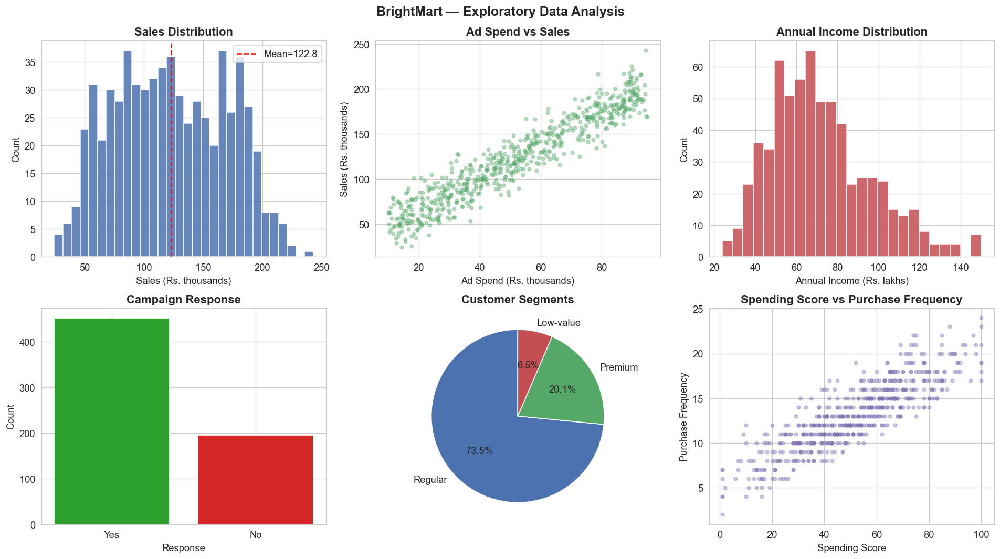
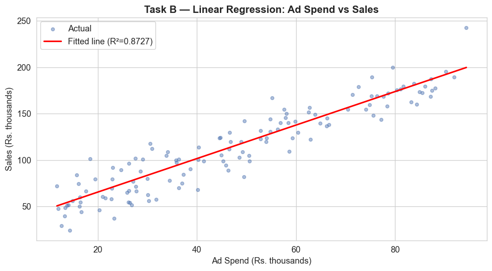
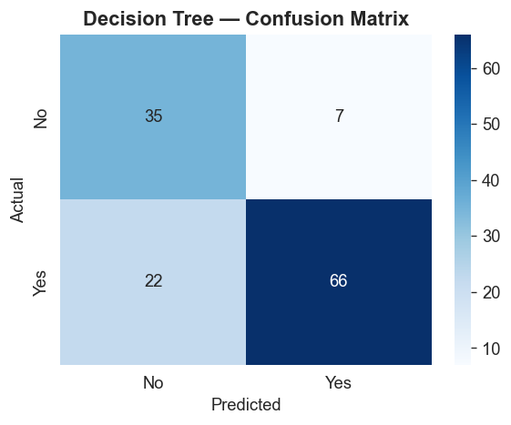
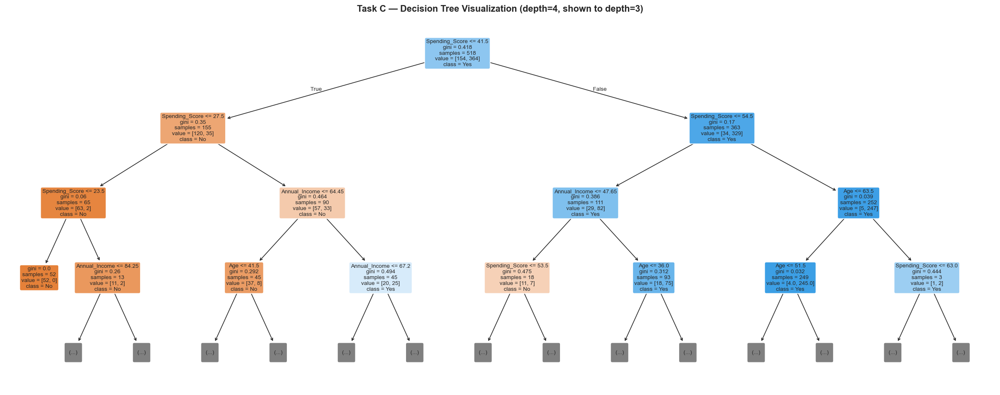
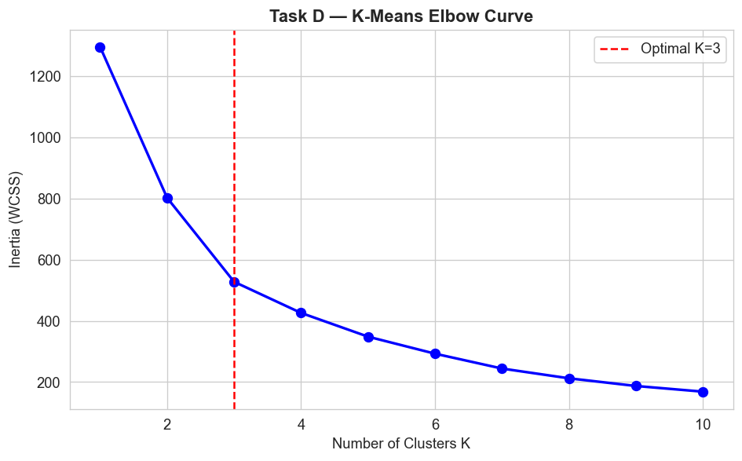
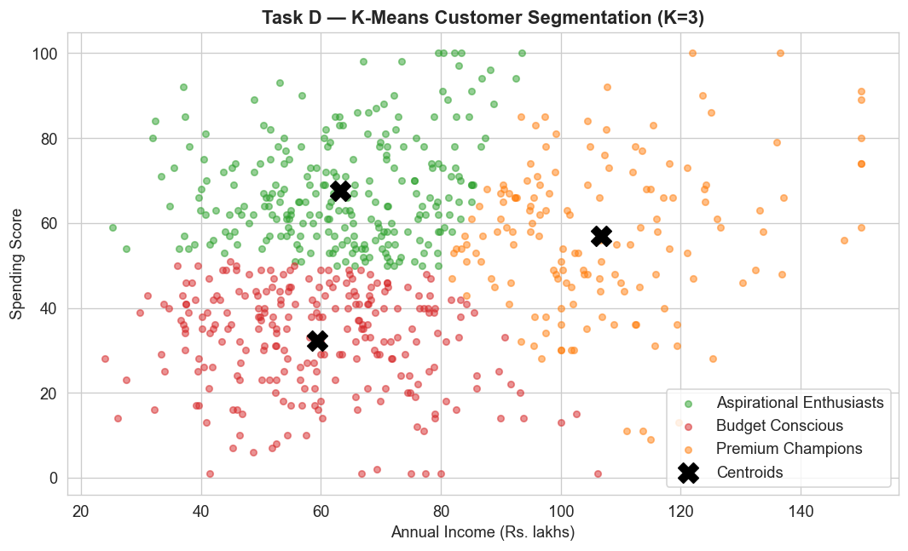
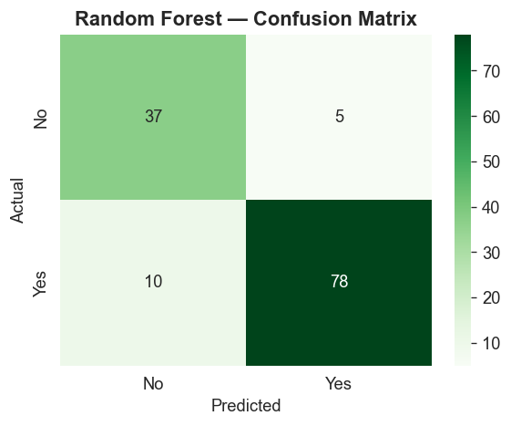
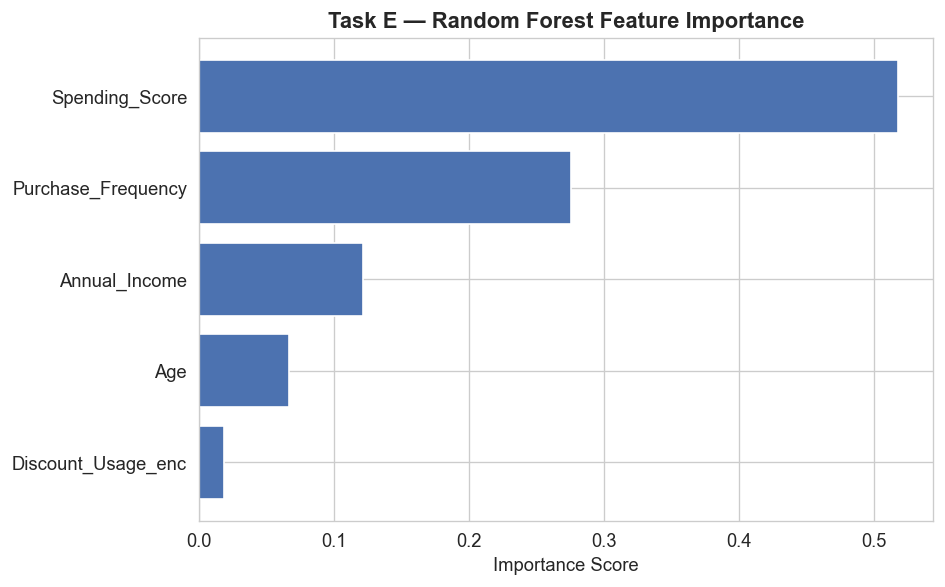

# BrightMart Retail — Customer Analytics & Machine Learning

<div align="center">

> **Mini Project | Analytical Modelling with Machine Learning**

[](https://github.com/koundal-aryan/BrightMart-customer-analytics-machine-learning/blob/main/customer_analytics_ml_project.ipynb)
[](https://github.com/koundal-aryan/BrightMart-customer-analytics-machine-learning/blob/main/BrightMart_ML_Dataset.csv)
[](https://github.com/koundal-aryan/BrightMart-customer-analytics-machine-learning)

</div>

---

## 1. Project Overview

A complete end-to-end machine learning project for **BrightMart Retail** that applies four ML models to analyse 648 synthetic retail customer records. The project covers data preparation, exploratory analysis, sales prediction, customer classification, and customer segmentation.

| Item | Detail |
|------|--------|
| **Dataset** | `BrightMart_ML_Dataset.csv` — 648 records, 10 features |
| **Models** | Linear Regression · Decision Tree · K-Means · Random Forest |
| **Author** | Aryan Koundal |
| **Notebook** | `customer_analytics_ml_project.ipynb` |

### Model Results Summary

| Model | Task | Accuracy / R² | F1 / MAE |
|-------|------|--------------|---------|
| **Linear Regression** | Sales Prediction | R² = **0.8727** | MAE = ₹13.10k |
| **Decision Tree** | Campaign Response | Acc = **77.69%** | F1 = 0.8199 |
| **K-Means (K=3)** | Customer Segmentation | 3 segments found | — |
| **Random Forest** | Campaign Response | Acc = **88.46%** | F1 = 0.9123 ✅ |

---

## 2. Dataset

**File:** `BrightMart_ML_Dataset.csv` — 648 rows after cleaning

| Column | Type | Description |
|--------|------|-------------|
| `Customer_ID` | String | Unique customer identifier |
| `Age` | Integer | Customer age (years) |
| `Annual_Income` | Float | Annual income (₹ lakhs) |
| `Spending_Score` | Integer | Spending propensity (1–100) |
| `Purchase_Frequency` | Integer | Purchases per period |
| `Discount_Usage` | String | Low / Medium / High |
| `Ad_Spend` | Float | Advertising spend (₹ thousands) |
| `Sales` | Float | Revenue generated (₹ thousands) |
| `Campaign_Response` | String | Yes / No |
| `Customer_Segment` | String | Budget / Regular / Premium |

---

## 3. Exploratory Data Analysis — Task A

Six visualizations covering sales distribution, ad spend vs sales relationship, income distribution, campaign response, customer segments, and spending behaviour.



**Key Findings:**
- Sales range from ₹30k to ₹250k with mean ≈ ₹122.8k
- Strong positive relationship between Ad Spend and Sales (confirmed by regression)
- Campaign response: 452 Yes (69.8%) · 196 No (30.2%)
- Income distribution is right-skewed — most customers earn ₹40–100L

---

## 4. Linear Regression — Task B

**Objective:** Predict `Sales` from `Ad_Spend`  
**Split:** 80% train / 20% test (`random_state=42`)



### Results

| Metric | Value | Interpretation |
|--------|-------|----------------|
| **Slope (β₁)** | 1.8039 | Each ₹1k more Ad Spend → ₹1.80k more Sales |
| **Intercept (β₀)** | 29.4848 | Base sales with zero ad spend |
| **MAE** | ₹13.10k | Average prediction error |
| **R² Score** | 0.8727 | Model explains **87.3%** of variance in Sales |

**Prediction:** For an ad budget of **₹60k**, the model predicts **₹137.72k** in Sales.

**Business Interpretation:** Ad spend is a strong and reliable driver of sales (R²=0.87). For every additional ₹1,000 invested in advertising, BrightMart can expect approximately ₹1.80k in additional revenue, providing a clear basis for budget planning.

---

## 5. Decision Tree Classifier — Task C

**Target:** `Campaign_Response` (Yes/No)  
**Features:** Age, Annual_Income, Purchase_Frequency, Discount_Usage, Spending_Score  
**Max Depth:** 4

### Metrics

| Metric | Value |
|--------|-------|
| **Accuracy** | 77.69% |
| **Precision** | 0.9041 |
| **Recall** | 0.7500 |
| **F1-Score** | 0.8199 |

### Confusion Matrix



| | Predicted No | Predicted Yes |
|---|---|---|
| **Actual No** | 35 (TN) | 7 (FP) |
| **Actual Yes** | 22 (FN) | 66 (TP) |

### Decision Tree Visualization



### Two Key Decision Rules

**Rule 1:** `Spending_Score ≤ 23.5` → **Predict No** (will not respond)
> 65 training customers fall here and 63 did not respond (97%). Do not spend advertising budget on them.

**Rule 2:** `Spending_Score > 54.5` and `Age ≤ 63.5` → **Predict Yes** (will respond)
> 252 customers fall here and 247 responded (98%). This is the core audience for every campaign.

---

## 6. K-Means Segmentation — Task D

**Features:** Annual_Income + Spending_Score (StandardScaler applied)  
**Optimal K:** 3 (selected via Elbow method)

### Elbow Curve



### Customer Clusters



### Cluster Profiles

| Cluster | Label | % Customers | Avg Income | Avg Spending Score | Avg Purchase Freq |
|---------|-------|------------|-----------|-------------------|------------------|
| 2 | **Premium Champions** | 23.1% | ₹106.7L | 56.9 | 13.9 |
| 0 | **Aspirational Enthusiasts** | 38.3% | ₹63.3L | 67.7 | 15.7 |
| 1 | **Budget Conscious** | 38.6% | ₹59.3L | 32.4 | 10.2 |

---

## 7. Random Forest — Task E

**Same target and features as Decision Tree** — 100 trees, max_depth=5

### Model Comparison: Decision Tree vs Random Forest

| Metric | Decision Tree | Random Forest | Winner |
|--------|--------------|---------------|--------|
| **Accuracy** | 77.69% | 88.46% | RF ✅ |
| **Precision** | 0.9041 | 0.9398 | RF ✅ |
| **Recall** | 0.7500 | 0.8864 | RF ✅ |
| **F1-Score** | 0.8199 | 0.9123 | RF ✅ |

> Random Forest outperforms Decision Tree on all metrics because it averages 100 trees, reducing variance and overfitting compared to a single tree.

### Random Forest Confusion Matrix



| | Predicted No | Predicted Yes |
|---|---|---|
| **Actual No** | 37 (TN) | 5 (FP) |
| **Actual Yes** | 10 (FN) | 78 (TP) |

### Feature Importance



| Feature | Importance |
|---------|-----------|
| `Spending_Score` | 0.5177 |
| `Purchase_Frequency` | 0.2753 |
| `Annual_Income` | 0.1217 |
| `Age` | 0.0670 |
| `Discount_Usage_enc` | 0.0183 |

> ⚠️ **Feature importance ≠ Causation.** A high importance score means the feature is useful for prediction — NOT that it directly causes campaign response. Correlation with unobserved factors (e.g., lifestyle) may be driving the result.

---

## 8. Business Recommendations — Task F

### Segment-Based Marketing Strategies

| Segment | Size | Strategy |
|---------|------|---------|
| **Premium Champions** | 23.1% | Loyalty rewards, premium bundles, early access, VIP events |
| **Aspirational Enthusiasts** | 38.3% | Aspirational product offers, EMI options, upsell to premium |
| **Budget Conscious** | 38.6% | Discount-led campaigns, value packs, cashback rewards |

### Advertising Budget Recommendation
- Use **Linear Regression** (R²=0.87) to set budgets — every ₹1k spent → ₹1.80k revenue
- Use **Random Forest** (F1=0.9123) to pre-qualify campaign recipients → reduce wasted outreach
- Allocate highest budgets to **Premium Champions** (highest conversion probability)

### Model Limitations

1. **Synthetic Data** — Dataset is artificially generated; real patterns may differ significantly
2. **Diminishing Returns** — Linear Regression assumes constant ROI; real ad spend shows saturation at high values
3. **Missing Context** — Seasonality, competitor activity, and economic conditions are not modelled
4. **Binary Simplification** — Campaign response is Yes/No; real engagement spans a spectrum

### Monitoring Recommendations

| Action | Frequency | Alert Threshold |
|--------|-----------|----------------|
| Retrain all models | Monthly | On new data batch |
| Monitor R² on validation set | Weekly | Alert if R² < 0.75 |
| Track feature distribution drift | Monthly | PSI > 0.2 → trigger review |
| A/B test cluster strategies | Per campaign | Uplift > 5% to adopt |

---

## 9. Analysis Questions Q1–Q9

**Q1. What is the relationship between Ad_Spend and Sales?**  
Strong positive linear relationship (R²=0.87). Each ₹1k of ad spend generates ~₹1.80k in sales.

**Q2. How well does Linear Regression predict Sales?**  
R²=0.8727 and MAE=₹13.10k — the model explains 87.3% of sales variance, making it highly reliable for budget planning.

**Q3. Which features best predict Campaign Response?**  
Per Random Forest importance: `Spending_Score` and `Purchase_Frequency` are the top predictors of campaign response.

**Q4. How does Decision Tree differ from Random Forest?**  
Random Forest outperforms Decision Tree on all metrics (Accuracy +10.8%, F1 +0.0924). RF reduces overfitting by averaging 100 decision trees.

**Q5. What are the 3 customer segments?**  
**Premium Champions** (high income + high spend), **Aspirational Enthusiasts** (mixed profile), and **Budget Conscious** (low income + low spend).

**Q6. Why is feature importance NOT causation?**  
Importance measures prediction utility — a feature can correlate with the target without causing it. A third unobserved factor may drive both.

**Q7. What do confusion matrices reveal?**  
False Negatives (missing real respondents) are the costlier error type for BrightMart. Random Forest has fewer FNs than Decision Tree (10 vs 22).

**Q8. What action for Budget Conscious segment?**  
Target with price-sensitive offers — discount bundles, cashback rewards, and value messaging. Avoid premium campaigns with low conversion probability for this segment.

**Q9. How to monitor models after deployment?**  
Retrain monthly on new data, track R² weekly (alert < 0.75), monitor feature drift with PSI, and A/B test segment strategies per campaign cycle.

---

## 10. Conclusion

This project applied four machine learning models to BrightMart's synthetic retail dataset of 648 customer records.

**Linear Regression** established that advertising spend is a strong, quantifiable driver of sales (R²=0.87), providing a reliable basis for budget decisions. **Decision Tree classification** achieved 77.7% accuracy in predicting campaign response with interpretable rules directly usable by marketing teams. **K-Means clustering** revealed three actionable customer segments — Premium Champions, Aspirational Enthusiasts, and Budget Conscious — each requiring distinct strategies. **Random Forest** delivered the strongest performance (88.5% accuracy, F1=0.9123), confirming that ensemble methods outperform single trees by reducing overfitting.

The core business insight is that combining segmentation with predictive modelling enables BrightMart to shift from broad, expensive campaigns to targeted, ROI-positive outreach. Future work should incorporate real transaction data, temporal features, and geographic information to further improve model accuracy and business applicability.

---

## 11. Files & Setup

```
BrightMart-customer-analytics-machine-learning/
├── customer_analytics_ml_project.ipynb   ← Complete notebook (Tasks A–F, Q1–Q9)
├── BrightMart_ML_Dataset.csv             ← Dataset (648 records)
├── plots/                                ← All chart images
│   ├── eda_overview.png
│   ├── regression_line.png
│   ├── dt_confusion_matrix.png
│   ├── decision_tree.png
│   ├── kmeans_elbow.png
│   ├── kmeans_clusters.png
│   ├── rf_confusion_matrix.png
│   └── feature_importance.png
├── requirements.txt
└── README.md
```

### Run the Notebook

```bash
pip install -r requirements.txt
jupyter notebook customer_analytics_ml_project.ipynb
```

### Requirements

```
pandas>=1.5.0
numpy>=1.23.0
matplotlib>=3.6.0
seaborn>=0.12.0
scikit-learn>=1.2.0
jupyter>=1.0.0
```

---

<div align="center">

**Author: Aryan Koundal**  
[GitHub Repository](https://github.com/koundal-aryan/BrightMart-customer-analytics-machine-learning)

</div>
